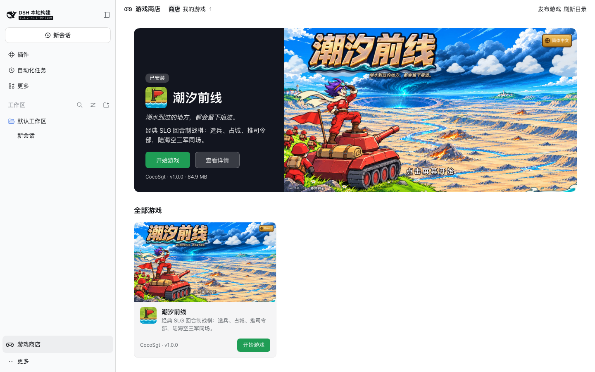

# DSH Game Store

[中文](README.zh-CN.md) · Site: <https://dsh-game-store.com>

A game store for DeepSeek Harness (DSH). With this plugin you browse games, read about them, install with one click and play full screen, all inside DSH. Games run on your own computer.

## Add your game

Copy this line and give it to your agent (Claude Code, Codex, DSH and so on):

```text
Read https://dsh-game-store.com/SKILL.md and publish my game to the DSH Game Store
```

It packs, checks and publishes the game to npm, then opens a pull request here. A pull request that changes only its author's own entry and passes every check merges by itself. The instructions agents read are in [SKILL.md](SKILL.md) (Chinese, commands are universal); to do it by hand, see [Publish your game](docs/publish.en.md).

## What is in this repository

This repository holds four things:

| Where | What |
| --- | --- |
| `lib/`, `cordis.patch.yml` | The store plugin (npm package `dsh-game-store`) |
| `SPEC.en.md`, `docs/` | The platform spec, the install guide, the publishing guide |
| `catalog/games/`, `catalog/workshop/` | The catalog: one file per game and per extension |
| `site/` | The generator for dsh-game-store.com |



## Players: install

Install `dsh-game-store` on DSH's Plugins page, or:

```bash
dsh plugin --profile web add dsh-game-store
```

Details: [install guide](docs/install.en.md).

## Developers: publish a game

```bash
npx dsh-game-store init dsh-game-my-game
```

```bash
npx dsh-game-store check dsh-game-my-game
```

Then publish to npm and open a pull request here that adds one file to `catalog/games/`. Every step is in [Publish your game](docs/publish.en.md); the rules are in the [spec](SPEC.en.md).

## How it works

- **A game is an npm package** with the game's files, a manifest `game.json`, a description, a cover and screenshots. It is also a DSH plugin with no code at all, so DSH's plugin manager can install and remove it.
- **The catalog is on GitHub.** `catalog/games/<id>.json` points at one exact version of a game package and its checksum. Listing, updating and taking down a game are pull requests that change this file.
- **CI checks every pull request**: the entry, the checksum on npm, the package's structure, description, pictures, size and license. Packages are downloaded, never run.
- **The site is static**, generated from the catalog together with the `catalog.json` the store reads.
- **The store installs only versions registered in the catalog**, and compares the checksum before and after installing.
- **Each game runs at its own local address**, fills the window, has no network access and cannot reach DSH data.
- **Games also play on the site**, each on its own subdomain `<id>.play.dsh-game-store.com`.
- **The Workshop**: everything is a plugin. An extension for a game (a map, a commander, a language pack) is an npm package too, registered in `catalog/workshop/<game>/` and installed, switched on and off in the Workshop section of the game page. See the [Workshop guide](docs/workshop.en.md).
- **Automatic merge**: a pull request that changes only its author's own entries and passes every check merges by itself.
- **Message boards are GitHub issues**; the account is a GitHub account.

What the safety measures do and do not cover: [section 9 of the spec](SPEC.en.md#9-safety).

## Development

No build step and no dependencies. Node.js 22 or newer.

```bash
npm test
```

```bash
node scripts/check-catalog.mjs
```

```bash
node site/build.mjs
```

The site is written to `site/dist/`. Preview it:

```bash
npx serve site/dist
```

While a game package is not on npm yet, put `{ "package-name": "path/to/tarball.tgz" }` in `catalog/local.json`; the check and the build use the local file (the checksum is still compared).

Before publishing the plugin, run `node site/build.mjs --snapshot` to refresh the catalog copy shipped inside it (`catalog-snapshot/`).

Testing inside DSH needs a separate home folder. How, and what was learned about DSH, is in [docs/dsh-research.md](docs/dsh-research.md) (Chinese).

## License

The store's code is MIT licensed. Each game in the catalog has its own license, shown on its page.
