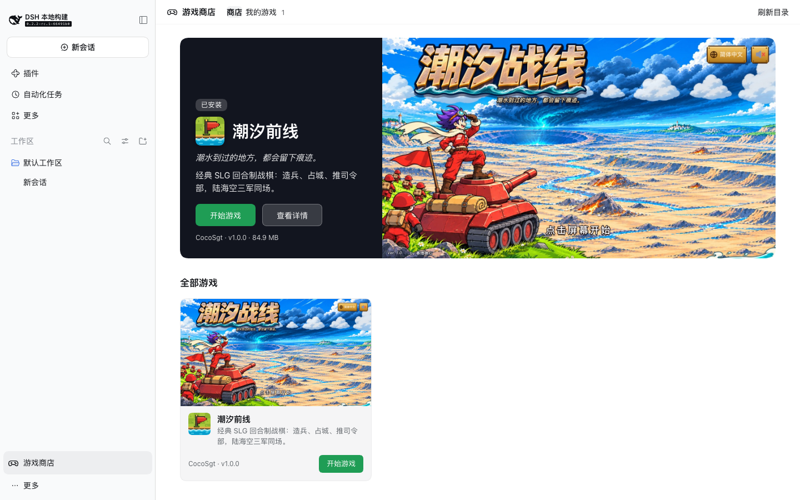

# DSH 游戏商店

[English](README.md) · 网站：<https://dsh-game-store.com>

DeepSeek Harness（DSH）上的游戏商店。装上这个插件，就能在 DSH 里浏览游戏、看说明、一键安装、全屏开玩。游戏都在你自己的电脑上运行。

这个仓库里有四样东西：

| 位置 | 是什么 |
| --- | --- |
| `lib/`、`cordis.patch.yml` | 商店插件本体（npm 包 `dsh-game-store`） |
| `SPEC.md`、`docs/` | 平台规范、安装说明、发布说明 |
| `catalog/games/`、`catalog/workshop/` | 目录：每个游戏、每个扩展一个文件 |
| `site/` | 网站 dsh-game-store.com 的生成脚本 |



## 玩家：安装

在 DSH 的插件页里安装 `dsh-game-store`，或者：

```bash
dsh plugin --profile web add dsh-game-store
```

详细步骤见[安装说明](docs/install.zh.md)。

## 开发者：发布游戏

```bash
npx dsh-game-store init dsh-game-my-game
```

```bash
npx dsh-game-store check dsh-game-my-game
```

然后发布到 npm，向这个仓库提一个 Pull Request，在 `catalog/games/` 里加一个文件。完整步骤见[怎么发布你的游戏](docs/publish.zh.md)，规则见[规范](SPEC.md)。

## 它怎么工作

- **一个游戏是一个 npm 包**，里面有游戏文件、游戏清单 `game.json`、说明、封面和截图。它同时是一个不带任何代码的 DSH 插件，所以 DSH 的插件管理器能安装和卸载它。
- **目录在 GitHub 上**。`catalog/games/<id>.json` 指向一个游戏包的确切版本和校验值。上架、更新、下架都是改这个文件的 Pull Request。
- **CI 检查每个 Pull Request**：条目格式、npm 上的校验值、游戏包的结构、说明、图片、大小、许可证。只下载，不运行。
- **网站是静态的**，从目录生成，同时生成商店读的 `catalog.json`。
- **商店只装目录里登记的版本**，装前装后各核对一次校验值。
- **每个游戏在自己的本地地址里运行**，占满窗口，联不了网，碰不到 DSH 的数据。
- **网站上也能玩**：每个游戏在自己的子域名 `<id>.play.dsh-game-store.com` 里运行。
- **插件工坊**：一切皆插件。给游戏做的扩展（地图、指挥官、语言包……）也是 npm 包，登记在 `catalog/workshop/<游戏>/`，在游戏页的“插件工坊”里安装、启用、停用。见[插件工坊说明](docs/workshop.zh.md)。
- **自动合并**：只动自己的条目、账号是仓库主人、检查全过的 Pull Request 不用等人。日常巡检的安排见[免维护方案](docs/maintenance.zh.md)。
- **留言板用 GitHub issue**，账号就是 GitHub 账号。

安全方面做到了什么、做不到什么，见[规范第 9 节](SPEC.md#9-安全)。

## 开发

没有构建步骤，没有依赖。需要 Node.js 22 以上。

```bash
npm test
```

```bash
node scripts/check-catalog.mjs
```

```bash
node scripts/patrol.mjs
```

```bash
node site/build.mjs
```

网站生成在 `site/dist/`（同时生成 `vercel.json`）。本地预览：

```bash
npx serve site/dist
```

游戏包还没发布到 npm 时，在 `catalog/local.json` 里写 `{ "包名": "本地 tarball 路径" }`，检查和生成脚本会用本地文件（校验值照样比对）。

部署网站（已经连到 Vercel 项目 `dsh-game-store`）：

```bash
node site/build.mjs && cd site/dist && vercel deploy --prod --yes
```

发布插件前运行 `node site/build.mjs --snapshot`，更新插件自带的那份目录（`catalog-snapshot/`）。

在 DSH 里测试要用独立的家目录，做法和 DSH 的各项结论记在 [docs/dsh-research.md](docs/dsh-research.md)。

## 许可证

商店的代码用 MIT 许可证。目录里每个游戏有自己的许可证，写在游戏页上。
